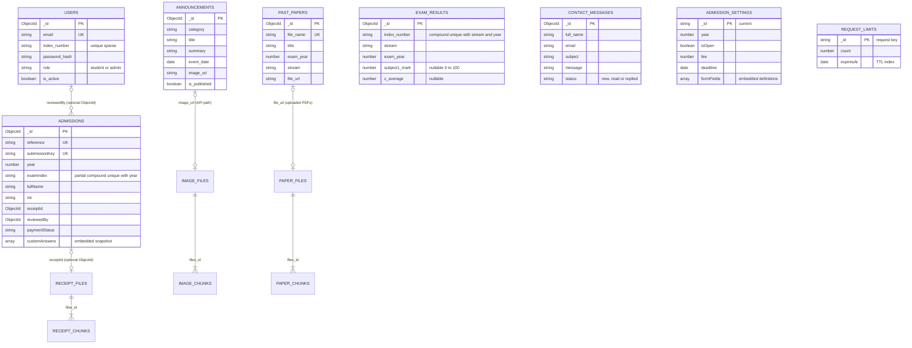

# MongoDB database design

Schemas: `backend/models/index.js` and `backend/models/admissions.js`.
The diagram shows application-level associations, not SQL foreign keys.
MongoDB does not enforce cross-collection relationships or cascading deletion.

## Collections and constraints

| Collection | Constraints and purpose |
|---|---|
| `users` | Unique lowercase email; optional unique sparse index number; hidden password hash; student/admin roles. Reset hashes and session version support recovery and session invalidation. |
| `announcements` | Required category, title and summary with length limits; optional date/image and publication flag. API rejects impossible dates and requires admin access for changes. |
| `past_papers` | Unique file name; required title, subject, stream, year and URL. Seeded PDFs may be static; uploaded PDFs use local disk or GridFS depending on environment. |
| `exam_results` | Unique `(index_number, stream, exam_year)`. Marks range 0-100; missing marks remain null. Excel imports use transactions on a replica set. |
| `contact_messages` | Required name/email/subject/message; status enum. Email is not a foreign key to a user. |
| `admission_settings` | Singleton string ID `current`; embedded form fields, centres, fee, dates and instructions. Form updates include version conflict protection. |
| `admissions` | Unique reference and retry submission key; partial unique `(year, examIndex)` when index is a string. New applications require NIC at API level; older records may omit it. Stores historical form answers. |
| `request_limits` | Request counters with expiry TTL index. Expired entries are removed asynchronously by MongoDB. |
| GridFS | `admission_receipts`, `announcement_images`, `paper_files`: each bucket uses `.files` and `.chunks`, connected by `files_id`. |

## Relationship and history decisions

- `reviewedBy` stores the reviewing user's ObjectId, with no Mongoose `ref` or database foreign-key constraint. Admin-authenticated routes assign it.
- `receiptId` points to `admission_receipts.files`. Receipt downloads require admin authentication.
- Announcement image and uploaded-paper associations use API paths. Static assets have no GridFS record.
- Public admissions do not require user accounts; there is no compulsory applicant-to-user relationship.
- Admission title, fee and labelled custom answers are snapshots. Changing current settings must not rewrite historical applications. No `settingsId` foreign key exists.
- Result index numbers and account index numbers are business identifiers, not an enforced join. Results can exist without registered accounts.
- Standard models use ObjectId `_id` and `created_at`/`updated_at`. Admissions/settings use `createdAt`/`updatedAt`; settings and request-limit keys use string IDs.
- API JSON exposes string `id` and excludes internal fields, password hashes and reset secrets.

## Deletion and limitations

Announcement deletion also attempts to remove its stored photo. This is application logic, not a database cascade; file-cleanup failure may require reconciliation. Receipt retention removes eligible files after one year and clears the reference while preserving applications and payment status. Backups need a separate retention policy. No application-wide audit log or automatic cross-collection integrity enforcement is implemented.
